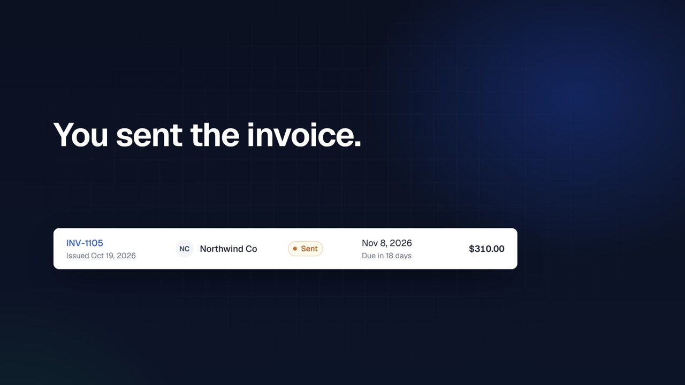
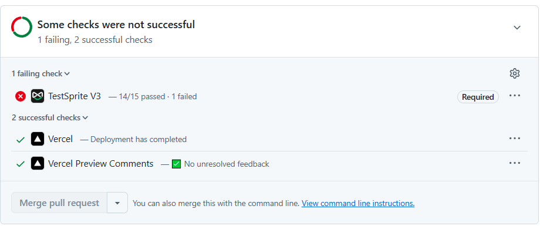

# Nudge

**Freelancers give each client a private login that shows only their own invoices — so you stop emailing PDFs and you can finally see who's opened one and who hasn't paid.**

**Live:** https://nudge-spike.vercel.app
**Every pull request is tested by TestSprite against its own Vercel preview, backed by its own freshly seeded Neon database branch — and a failing check blocks the merge.** [PR #10](https://github.com/hackid02/nudge-spike/pull/10) proves it: a planted tenant leak turned the check red and GitHub refused to merge.

[](docs/nudge-demo.mp4)

**[▶ Watch the 2-minute demo](docs/nudge-demo.mp4)** — the live read receipt, a cross-client URL attack, and the TestSprite loop, with voice-over and captions.

## Try it

The sign-in page has three one-click demo buttons — no credentials to type.

| Sign in as | Sees |
|---|---|
| **Freelancer** (Maya) | All of her invoices, with Send, Record payment, Void and Delete |
| **Client A** (Northwind) | Only Northwind's invoices |
| **Client B** (Lumen) | Only Lumen's invoices |

Both clients belong to the *same* freelancer. That's the interesting case: cross-freelancer isolation is easy to remember; cross-client isolation within one freelancer is what real apps get wrong.

**Try it:** sign in as Client A, then open `/portal/invoices/INV-1002` — that's Client B's invoice. You get "Invoice not found.", and the page contains neither the invoice number nor its `$640.00` total. Then open **Account** (click your name) to see exactly what your login can see.

Also in the app: a live client-activity feed (the freelancer's dashboard updates within seconds when a client opens or pays), dark mode, and a layout that works from 390px phones up.

## Scope — what Nudge is and isn't (yet)

**Built and tested:** the client portal (each client sees only their own invoices), read receipts (the freelancer sees when a client opens an invoice), the invoice lifecycle on existing invoices (send, record payment, void, delete), CSV export, and per-tenant isolation enforced in SQL.

**Not built:** creating or editing invoices, inviting clients, email delivery and online payments. The demo runs on seeded invoices. We chose to spend the week making the isolation and lifecycle provably correct rather than adding forms we couldn't test properly.

## How every PR is verified

1. A PR opens → Vercel builds a preview deployment.
2. The Neon–Vercel integration gives that preview **its own database branch** (`preview/<branch>`), and `scripts/preview-reset.mjs` reseeds it at build time. Concurrent PRs can't see each other's writes, and a PR run never touches the live demo. (Manual runs started from the TestSprite portal do target the live URL — which is why the demo is reseeded nightly; see *Keeping the live demo clean*.)
3. When the deployment reports ready, the **TestSprite GitHub App** runs the suite against that preview and posts a **TestSprite V3** check plus a pass/fail comment on the PR.
4. The check is **blocking**: TestSprite's *Merge gate* reports any failed test as a failed **TestSprite V3** status, and a repository ruleset on `main` requires that status — so the merge button stays disabled until the suite passes.
5. A second, credit-free layer runs on every PR too: the **unit-tests** GitHub Action (`npm test`, 21 money checks).

**Evidence:**

| PR | What happened |
|---|---|
| [#10](https://github.com/hackid02/nudge-spike/pull/10) | **Planted regression, closed unmerged.** We deleted one line — `and i.client_id = ${clientId}` — so a client could open any invoice by URL. TestSprite failed *"Client A cannot access Client B invoice by URL"* (it saw Lumen Labs' INV-1002, $640.00), the required check went red (**14/15 passed · 1 failed**), and GitHub blocked the merge. |
| [#8](https://github.com/hackid02/nudge-spike/pull/8) | Added three boundary tests; **15 of 15** green, merged after the required check passed. |
| [#6](https://github.com/hackid02/nudge-spike/pull/6) | Wrong-password test; **12 of 12** green. Earlier: [#4](https://github.com/hackid02/nudge-spike/pull/4) — 11 of 11. |



**Honest history — the gate wasn't fully on until PR #10.**
- PRs #1–#3 and #5 carry no TestSprite check: #1–#3 were merged while the suite and trigger were still being built, #5 before the ruleset existed.
- The ruleset has required **TestSprite V3** since #6, and #6–#9 were all green. But PR #10's *first* run exposed a gap: it reported **success — 14/15 passed · 1 failed**, because TestSprite's *Merge gate* toggle was off, so a failing test still produced a passing status. We switched the toggle on, re-ran (an empty commit, same code), and the check went red and blocked the merge. A gate you've never seen fail isn't a gate — that's why we planted the bug.

### The loop in action (what the suite caught)

In a portal run before PR #4, the test **"Maya can delete a draft invoice after confirming"** came back **Blocked**: Delete used the browser's native `window.confirm()`, and automated browsers auto-close native dialogs — so the cancel path could never be verified, by TestSprite or anyone else's harness.

PR #4 replaced it with an in-page confirmation dialog (`components/ConfirmDelete.tsx`). On that PR's run the test passed, and with the full steps it now clicks **Cancel** (invoice stays) and then **Confirm** (invoice is removed) — 9 actions, no errors.

Earlier portal runs also surfaced two real problems that we fixed rather than papered over: the seed script crashed before creating any of the six disposable invoices (so every mutating test had nothing to act on), and the "void refused on paid invoices" path was unreachable because the Void button was hidden. Several other failures turned out to be test-design problems (tests sharing the same invoice, an incorrect assumption about which invoices belong to which client); those were fixed in the suite, not by changing correct app behaviour.

## What the suite covers

15 TestSprite tests, each signing in as the role it needs:

| Area | Test |
|---|---|
| Tenant isolation | Client A cannot access Client B invoice by URL |
| | Client A cannot view draft invoice |
| | Maya cannot access another freelancer invoice |
| | Client A export shows only Northwind invoices |
| | Client B export contains only Lumen invoices (no `INV-1001`, `INV-1004`, `INV-1007`) |
| | A client opening a freelancer page (`/invoices/INV-1001`) is sent back to `/portal` |
| Money | Maya sees correct invoice totals for INV-1001 (lines, subtotal $1,350.10, 5% tax $67.51, total $1,417.61 — on the detail page **and** the dashboard row) |
| Lifecycle | Maya can send a draft invoice |
| | Maya can record payment for a sent invoice |
| | Maya cannot void a paid invoice (exact text: `Paid invoices can't be voided.`) |
| | Maya can delete a draft invoice after confirming (Cancel keeps it, Confirm removes it) |
| Read receipts | Client A opening an invoice marks it viewed for Maya |
| Routing | Role routing sends each user to the correct area |
| Auth | Wrong password is rejected with an exact error (`Invalid email or password.`, no session created) |
| | A signed-out visitor opening `/portal` or a portal invoice is sent to `/login`, with no invoice data shown |

Isolation cases assert the **absence of a specific value** (`INV-1002`, `$640.00`) rather than a generic "access denied", because a 200 with someone else's data on it passes a lazy assertion.

## How the tests stay honest

- **Each PR gets its own seeded database branch** (see above), so a red check is reproducible and never caused by another run.
- **Fixtures are read-only.** Invoices `INV-10xx` are never changed by any test; each mutating test owns exactly one `INV-11xx` disposable.
- **`viewed_at` is idempotent** — the update requires `status = 'sent'`, so re-opening a viewed invoice writes nothing.
- **Seed dates are relative to `now()`**, so fixtures never drift into Overdue during judging.
- **Exact strings live in one file** (`lib/messages.ts`), so tests assert real text, not "an error appeared".

## Architecture

Next.js (App Router) · Postgres on Neon · Tailwind v4 · Vercel preview deployments · TestSprite.

- **Ownership lives in the SQL `WHERE` clause.** Never fetch-then-filter in JavaScript — one forgotten `if` is a data leak, and it would make the isolation tests meaningless.
- **Money is integer cents.** Quantity is thousandths, tax is basis points, rounding is half-up per line and then on the tax. The SQL that totals lists and the CSV export uses the same rounding as `lib/money.ts`, so every screen shows the same total.
- **One not-found page for every invisible row.** Another client's invoice, another tenant's invoice, your own draft as a client, and a nonexistent id are indistinguishable — anything else confirms an invoice exists.

## Run locally

```bash
npm install
cp .env.example .env            # then fill in DATABASE_URL, DATABASE_URL_UNPOOLED, SESSION_SECRET
node --env-file=.env scripts/apply-schema.mjs
node --env-file=.env scripts/seed.mjs
npm run dev
npm test                        # money maths: rounding, tax, formatting (21 checks)
```

## Keeping the live demo clean

The live demo is shared by every visitor (and by any manual TestSprite run), so its data drifts. The **reseed-demo** GitHub Action resets it to the known fixtures every night at 02:00 UTC, and can be run on demand from the Actions tab (*reseed-demo → Run workflow*). It only runs from `main`, and does nothing until the `DEMO_DATABASE_URL` repository secret is set.

```bash
node scripts/check-isolation.mjs http://localhost:3000
```

`check-isolation.mjs` fires real HTTP requests at the tenant boundaries (13 checks) — a two-second local loop that doesn't spend TestSprite credits, and tells us whether a red TestSprite case means the app is broken or the test is.
